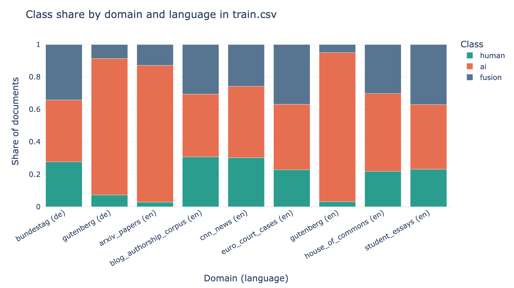
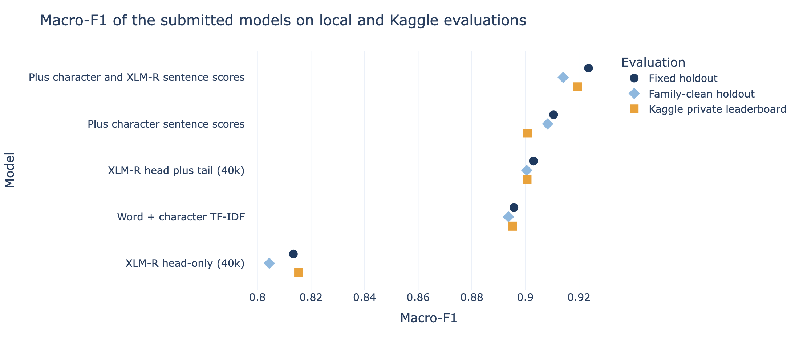

## Summary

I classify English and German texts as `human`, `ai` or `fusion`. Most fusion texts are human texts with a few rewritten sentences, so I added sentence-level rewrite scores to a TF-IDF logistic regression. This raises holdout macro-F1 from 0.8957 to 0.9236 and scores 0.91950 on the private leaderboard.

$$
F1_{\mathrm{macro}} = \frac{F1_{\mathrm{human}} + F1_{\mathrm{ai}} + F1_{\mathrm{fusion}}}{3}
$$

## 1. Data and EDA

From EDA findings found that classes are imbalanced: `ai` makes up 44.8% of the training texts, `fusion` 30.7% and `human` 24.5% ([eda_1](https://nbviewer.org/github/ke1rro/hm3-ai/blob/main/notebooks/01_eda.ipynb#02%E2%80%9303-%C2%B7-Class,-language,-and-domain)). 

The percentage of English texts is (80.6%), while the German ones are almost all Bundestag speeches. 

The balance also depends on the domain: arXiv papers and Gutenberg books are mostly `ai` (84 to 92%), whereas the other six domains are close to the overall mix (Figure 1). Since a model could learn the domain instead of the author, I use `lang` and `domain` only for stratification and diagnostics, not as model inputs.

The problem was the texts do not fit into 512 token length. The median length is 463 words. ([eda_1](https://nbviewer.org/github/ke1rro/hm3-ai/blob/main/notebooks/01_eda.ipynb#05-%C2%B7-XLM-R-tokenization-and-truncation)). An encoder therefore needs a rule for long texts, while TF-IDF always sees the whole text. The lengths of the three classes overlap, so length alone does not separate them ([eda_1](https://nbviewer.org/github/ke1rro/hm3-ai/blob/main/notebooks/01_eda.ipynb#04-%C2%B7-Document-length)).

The key finding is how fusion differs from human. I linked two documents when they share at least two sentences of eight or more words and called the linked groups *families*. 93.2% of fusion texts link to a human text, while AI texts almost never link to anything ([sentence_rewrite_4](https://nbviewer.org/github/ke1rro/hm3-ai/blob/main/notebooks/04_sentence_rewrite_experiments.ipynb#02-%C2%B7-Document-families-in-the-training-data)).

We could say that a fusion class is usually a human text with a few sentences changed. 

## 2. Validation protocol

For validation I used frozen split with seed 2026.

The first of five shuffled `StratifiedGroupKFold` folds by label $\times$ language $\times$ domain with NFKC-normalized duplicates grouped, gives 217,881 development and 54,471 holdout documents 
([baseline_2](https://nbviewer.org/github/ke1rro/hm3-ai/blob/main/notebooks/02_baseline.ipynb#02-%C2%B7-Frozen-holdout-and-CV-design)). 

Model selection uses development data only, and each experiment is evaluated once on the holdout. Because 23,822 holdout documents link to a development document, while the official split keeps families together, I also report the *family-clean* subset of 30,649 unlinked holdout documents ([sentence_rewrite_4](https://nbviewer.org/github/ke1rro/hm3-ai/blob/main/notebooks/04_sentence_rewrite_experiments.ipynb#02-%C2%B7-Document-families-in-the-training-data)).  

Each experiment changes one component of a fixed reference and has criteria fixed in advance: a gain of at least 0.003 with the interval above zero, no family-clean loss and a human F1 drop of at most 0.003.

## 3. Baseline: TF-IDF with linear models

Word 1 to 2-grams (40,000 features) and character 3 to 5-grams (60,000) use sublinear TF, `min_df=3` and preserved case and punctuation ([baseline_2](https://nbviewer.org/github/ke1rro/hm3-ai/blob/main/notebooks/02_baseline.ipynb#03-%C2%B7-Representations-and-controlled-experiment-matrix)). Three-fold CV on a fixed 30,002-document development sample compared four candidates with $C=1$ ([baseline_2](https://nbviewer.org/github/ke1rro/hm3-ai/blob/main/notebooks/02_baseline.ipynb#04-%C2%B7-Three-fold-CV-and-model-comparison)). Word and character TF-IDF with logistic regression wins (0.8480 $\pm$ 0.0022), ahead of character only (0.8418), the same features with a linear SVM (0.8310) and words only (0.8265). 
After refitting on all development documents, this model scores 0.8957 macro-F1 on the holdout. It almost never misses AI texts (F1 0.989), but it is weaker on human (0.841) and fusion (0.857) texts ([baseline_2](https://nbviewer.org/github/ke1rro/hm3-ai/blob/main/notebooks/02_baseline.ipynb#05-%C2%B7-CV-selected-model-and-fixed-validation-evaluation)). Its confusion matrix shows that 4,262 of the 4,778 errors are human/fusion confusions ([baseline_2](https://nbviewer.org/github/ke1rro/hm3-ai/blob/main/notebooks/02_baseline.ipynb#06-%C2%B7-Confusion-matrices-and-subgroup-diagnostics)).

## 4. Encoder: fine-tuned XLM-R

I fine-tuned `xlm-roberta-base` on 40,001 stratified development documents and selected checkpoints by macro-F1 on 2,001 others ([xlm_roberta_3](https://nbviewer.org/github/ke1rro/hm3-ai/blob/main/notebooks/03_xlm_roberta.ipynb#01-%C2%B7-Frozen-validation-and-shared-training-IDs)), with AdamW, learning rate $2 \times 10^{-5}$, effective batch 32, at most two epochs and early stopping ([xlm_roberta_3](https://nbviewer.org/github/ke1rro/hm3-ai/blob/main/notebooks/03_xlm_roberta.ipynb#03-%C2%B7-Token-budget,-optimizer-and-checkpoint-selection)). 

Head plus tail reaches 0.9030 against 0.8117 for head-only, +0.0913 $[0.0874, 0.0951]$, and the share of fusion documents predicted as human falls from 35.8% to 9.4% ([xlmr_long_text_5](https://nbviewer.org/github/ke1rro/hm3-ai/blob/main/notebooks/05_xlmr_long_text_policies.ipynb#02-%C2%B7-Fixed-holdout-comparison)). 

It meets the criteria, but I do not attribute the gain to the tail. Early stopping ended head-only after 0.8 epochs while head plus tail trained for two ([xlmr_long_text_5](https://nbviewer.org/github/ke1rro/hm3-ai/blob/main/notebooks/05_xlmr_long_text_policies.ipynb#01-%C2%B7-Verified-runs)), and documents of at most 128 words, identical under both policies, gain as much (+0.122) as those over 1,024 words (+0.127) ([xlmr_long_text_5](https://nbviewer.org/github/ke1rro/hm3-ai/blob/main/notebooks/05_xlmr_long_text_policies.ipynb#03-%C2%B7-Document-length)). 

Head plus tail beats the TF-IDF baseline overall (+0.0073 $[0.0041, 0.0107]$) but loses above 1,024 words (0.833 against 0.912, Figure 2). Sliding windows remain untested.

## 5. My approach: sentence rewrite evidence

**Hypothesis.** One or two rewritten sentences barely change a document-level bag of n-grams: the baseline's fusion recall falls from 0.958 for documents with six or more rewritten sentences to 0.505 for documents with one ([sentence_rewrite_4](https://nbviewer.org/github/ke1rro/hm3-ai/blob/main/notebooks/04_sentence_rewrite_experiments.ipynb#02-%C2%B7-Document-families-in-the-training-data)). A sentence classifier should add this local signal.

**Labels and features** ([sentence_rewrite_4](https://nbviewer.org/github/ke1rro/hm3-ai/blob/main/notebooks/04_sentence_rewrite_experiments.ipynb#04-%C2%B7-Experiment-1:-sentence-rewrite-scores)). In the development set, a sentence of eight or more words in a fusion document is *rewritten* if its normalized text is absent from every linked human document; sentences of human documents are negatives. This is a string comparison of training texts only, with no external data or LLM. Families linked to the holdout are excluded from sentence training, and development documents get out-of-fold scores from three family-grouped folds. Seven aggregates per document (maximum, top-two mean, mean, count and share of scores $\ge 0.5$, $\log(1+n)$ for $n$ sentences, empty flag), scaled to $[0, 1]$ and divided by $\sqrt{7}$, are appended to the reference TF-IDF matrix.

**Experiments**, each against a fixed reference (Figure 3):

1. *Character sentence scores* ([sentence_rewrite_4](https://nbviewer.org/github/ke1rro/hm3-ai/blob/main/notebooks/04_sentence_rewrite_experiments.ipynb#04-%C2%B7-Experiment-1:-sentence-rewrite-scores)). A 2 to 5-gram logistic regression with out-of-fold sentence AUC 0.937 on 2,072,920 sentences lifts holdout macro-F1 from 0.8957 to 0.9105, +0.0148 $[0.0125, 0.0170]$ and +0.0146 family-clean. Adopted. Only fusion documents without a rewritten eligible sentence lose recall (0.361 to 0.245).
2. *XLM-R sentence detector* ([sentence_rewrite_4](https://nbviewer.org/github/ke1rro/hm3-ai/blob/main/notebooks/04_sentence_rewrite_experiments.ipynb#08-%C2%B7-Experiment-3:-XLM-R-sentence-detector)). `xlm-roberta-base` fine-tuned for one epoch on 675,638 sentences of one family fold (two T4 GPUs, 81 minutes) reaches a document AUC of the maximum score of 0.924 against 0.886 for character n-grams. Its 27,622 training documents are removed from every logistic regression, so I compare against a character-only control on the same 190,259 rows: 0.9069 to 0.9236, +0.0166 $[0.0147, 0.0186]$ and +0.0104 family-clean. Adopted. XLM-R aggregates alone reach 0.9210.
3. *Fusion decision offset*, negative ([sentence_rewrite_4](https://nbviewer.org/github/ke1rro/hm3-ai/blob/main/notebooks/04_sentence_rewrite_experiments.ipynb#05-%C2%B7-Experiment-2:-fusion-decision-offset)). A constant $\delta$ added to $\log P(\mathrm{fusion})$ and selected on development CV came out as $-0.05$ and changed the holdout by +0.0003 $[-0.0004, 0.0010]$: argmax is already near the macro-F1 optimum.
4. *Equal-weight blend with XLM-R head-only*, negative ([sentence_rewrite_4](https://nbviewer.org/github/ke1rro/hm3-ai/blob/main/notebooks/04_sentence_rewrite_experiments.ipynb#06-%C2%B7-Fallback:-TF-IDF-and-XLM-R-probability-average)). Averaging probabilities changes holdout macro-F1 by $-0.0069$ $[-0.0094, -0.0042]$, as fusion recall drops from 0.828 to 0.779. Rejected.

## 6. Results, final model and submissions

The five submitted models rank identically on the holdout and on the private leaderboard (Figure 4; all scores in the appendix). The final model keeps most of its gain over the baseline (+0.0279 holdout, +0.0243 private), while the gain from character sentence scores alone shrinks from 0.0148 to 0.0056. Remaining errors stay on the human/fusion boundary: 9.1% of human documents are predicted as fusion and 11.1% of fusion documents as human ([sentence_rewrite_4](https://nbviewer.org/github/ke1rro/hm3-ai/blob/main/notebooks/04_sentence_rewrite_experiments.ipynb#08-%C2%B7-Experiment-3:-XLM-R-sentence-detector)).

The final model is word and character TF-IDF logistic regression ($C=1$) with seven character and seven XLM-R sentence aggregates, refitted on 244,730 training rows: all labeled rows except the 27,622 in the encoder's training families, with class weights restoring the class totals ([sentence_rewrite_4](https://nbviewer.org/github/ke1rro/hm3-ai/blob/main/notebooks/04_sentence_rewrite_experiments.ipynb#09-%C2%B7-Conclusions-and-limitations)). I did not mark submissions manually, so Kaggle selects those with the best public scores:

- `word_char_logreg_xlmr_sentence_rewrite_all_train.csv`, the final model: public 0.92308, private 0.91950;
- `word_char_logreg_sentence_rewrite_all_train.csv`, character sentence scores only: public 0.90893, private 0.90084.

Public scores were not used for any modeling decision.

## Appendix: all experiments and scores

| # | Experiment | Validation | Macro-F1 | Family-clean | Change (95% CI) | Public | Private | Notebook |
| ---: | --- | --- | ---: | ---: | --- | ---: | ---: | --- |
| 1 | Word TF-IDF, logistic regression | 3-fold CV, 30k | 0.8265 | | | | | [baseline_2](https://nbviewer.org/github/ke1rro/hm3-ai/blob/main/notebooks/02_baseline.ipynb#04-%C2%B7-Three-fold-CV-and-model-comparison) |
| 2 | Character TF-IDF, logistic regression | 3-fold CV, 30k | 0.8418 | | | | | [baseline_2](https://nbviewer.org/github/ke1rro/hm3-ai/blob/main/notebooks/02_baseline.ipynb#04-%C2%B7-Three-fold-CV-and-model-comparison) |
| 3 | Word + character TF-IDF, linear SVM | 3-fold CV, 30k | 0.8310 | | | | | [baseline_2](https://nbviewer.org/github/ke1rro/hm3-ai/blob/main/notebooks/02_baseline.ipynb#04-%C2%B7-Three-fold-CV-and-model-comparison) |
| 4 | Word + character TF-IDF, logistic regression | 3-fold CV, 30k | 0.8480 ± 0.0022 | | | | | [baseline_2](https://nbviewer.org/github/ke1rro/hm3-ai/blob/main/notebooks/02_baseline.ipynb#04-%C2%B7-Three-fold-CV-and-model-comparison) |
| 5 | Row 4 refitted on development data (reference) | holdout | 0.8957 | 0.8937 | reference | 0.90001 | 0.89524 | [baseline_2](https://nbviewer.org/github/ke1rro/hm3-ai/blob/main/notebooks/02_baseline.ipynb#05-%C2%B7-CV-selected-model-and-fixed-validation-evaluation) |
| 6 | XLM-R head-only, original loss scaling | holdout | 0.8134 | 0.8044 | | 0.81912 | 0.81536 | [xlm_roberta_3](https://nbviewer.org/github/ke1rro/hm3-ai/blob/main/notebooks/03_xlm_roberta.ipynb#07-%C2%B7-Measured-comparison-and-limitations) |
| 7 | XLM-R head-only, corrected loss | holdout | 0.8117 | 0.8025 | −0.0017 [−0.0040, 0.0005] vs 6 | | | [xlmr_long_text_5](https://nbviewer.org/github/ke1rro/hm3-ai/blob/main/notebooks/05_xlmr_long_text_policies.ipynb#02-%C2%B7-Fixed-holdout-comparison) |
| 8 | XLM-R head plus tail, corrected loss | holdout | 0.9030 | 0.9005 | +0.0913 [0.0874, 0.0951] vs 7; +0.0073 [0.0041, 0.0107] vs 5 | 0.90166 | 0.90067 | [xlmr_long_text_5](https://nbviewer.org/github/ke1rro/hm3-ai/blob/main/notebooks/05_xlmr_long_text_policies.ipynb#02-%C2%B7-Fixed-holdout-comparison) |
| 9 | Row 5 plus character sentence scores | holdout | 0.9105 | 0.9083 | +0.0148 [0.0125, 0.0170] vs 5 | 0.90893 | 0.90084 | [sentence_rewrite_4](https://nbviewer.org/github/ke1rro/hm3-ai/blob/main/notebooks/04_sentence_rewrite_experiments.ipynb#04-%C2%B7-Experiment-1:-sentence-rewrite-scores) |
| 10 | Row 5 with fusion offset $\delta=-0.05$ | holdout | 0.8960 | 0.8961 | +0.0003 [−0.0004, 0.0010] vs 5 | | | [sentence_rewrite_4](https://nbviewer.org/github/ke1rro/hm3-ai/blob/main/notebooks/04_sentence_rewrite_experiments.ipynb#05-%C2%B7-Experiment-2:-fusion-decision-offset) |
| 11 | Equal-weight average of rows 5 and 6 | holdout | 0.8888 | 0.8931 | −0.0069 [−0.0094, −0.0042] vs 5 | | | [sentence_rewrite_4](https://nbviewer.org/github/ke1rro/hm3-ai/blob/main/notebooks/04_sentence_rewrite_experiments.ipynb#06-%C2%B7-Fallback:-TF-IDF-and-XLM-R-probability-average) |
| 12 | Row 9 on 190,259 rows without encoder families (control) | holdout | 0.9069 | 0.9038 | control | | | [sentence_rewrite_4](https://nbviewer.org/github/ke1rro/hm3-ai/blob/main/notebooks/04_sentence_rewrite_experiments.ipynb#08-%C2%B7-Experiment-3:-XLM-R-sentence-detector) |
| 13 | Row 12 with XLM-R instead of character sentence scores | holdout | 0.9210 | 0.9137 | +0.0141 [0.0117, 0.0164] vs 12 | | | [sentence_rewrite_4](https://nbviewer.org/github/ke1rro/hm3-ai/blob/main/notebooks/04_sentence_rewrite_experiments.ipynb#08-%C2%B7-Experiment-3:-XLM-R-sentence-detector) |
| 14 | Row 12 plus XLM-R sentence scores (final) | holdout | 0.9236 | 0.9141 | +0.0166 [0.0147, 0.0186] vs 12 | 0.92308 | 0.91950 | [sentence_rewrite_4](https://nbviewer.org/github/ke1rro/hm3-ai/blob/main/notebooks/04_sentence_rewrite_experiments.ipynb#08-%C2%B7-Experiment-3:-XLM-R-sentence-detector) |
