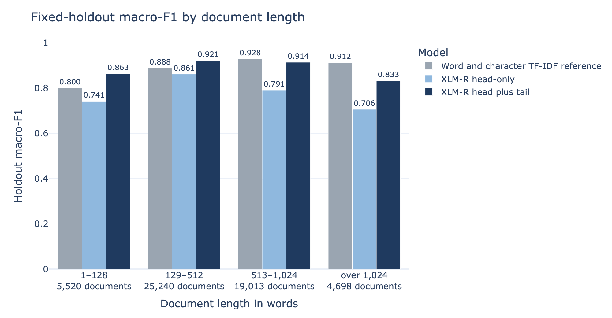
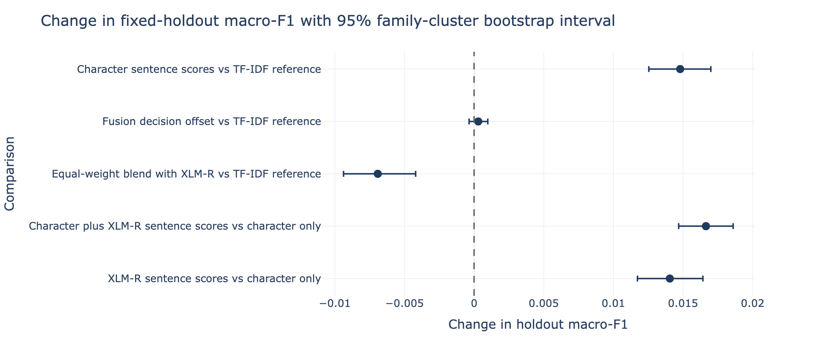
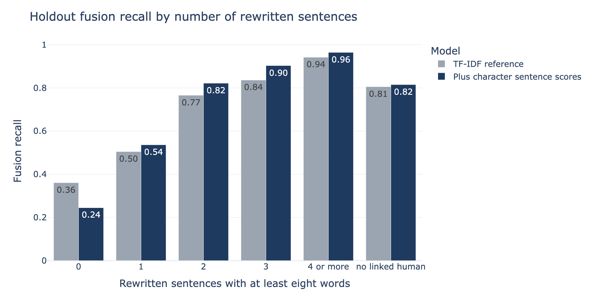
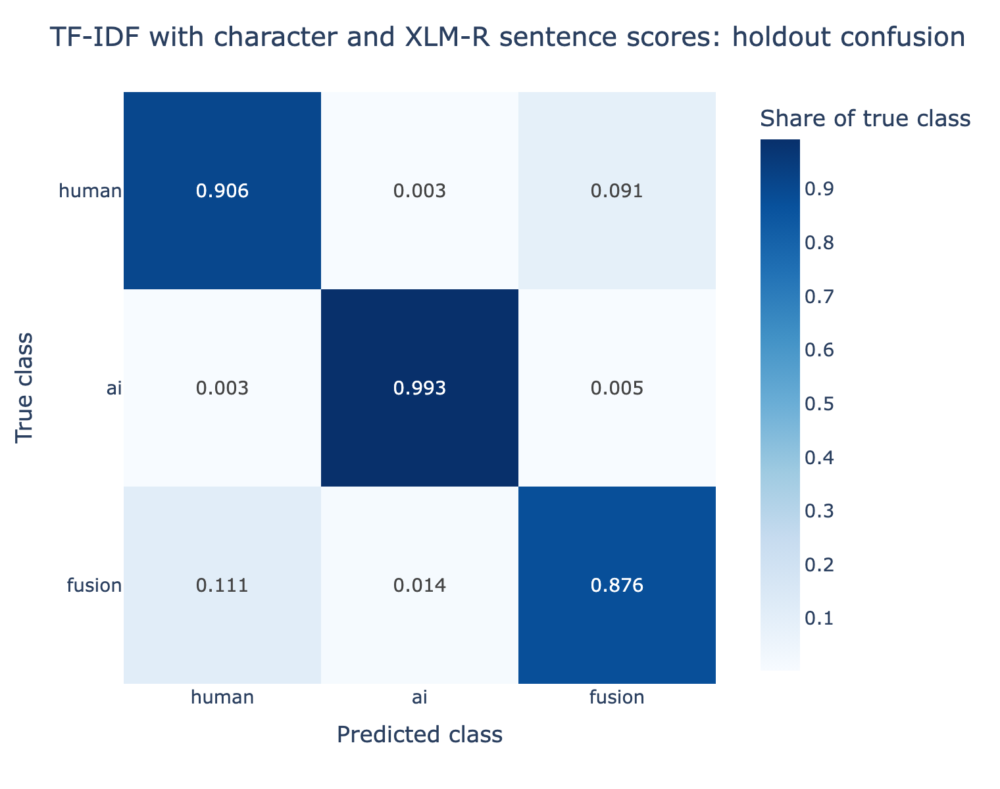

## Summary

> ✍️ **Написати самостійно (3–5 речень):** задача, головна ідея підходу, фінальна модель, обрані сабміти та їхні Public scores.

Facts for this section:

- Task: three-class classification (`human`, `ai`, `fusion`) of English and German texts; metric three-class macro-F1.
- Final model: word and character TF-IDF with logistic regression plus seven document aggregates from a character n-gram sentence classifier and seven from a fine-tuned XLM-R sentence classifier. Fixed-holdout macro-F1 0.9236; Kaggle Public 0.92308.
- Submitted files: `word_char_logreg_xlmr_sentence_rewrite_all_train.csv` (Public 0.92308) and `word_char_logreg_sentence_rewrite_all_train.csv` (Public 0.90893). Final selection: ✍️ TODO.

## EDA (Exploratory Data Analysis)

> ✍️ **Написати самостійно:** що показує розподіл класів за мовою й доменом, довжини текстів, чим відрізняється `fusion` і як це вплинуло на вибір підходу.


Facts for this section ([01_eda](https://nbviewer.org/github/ke1rro/hm3-ai/blob/main/notebooks/01_eda.ipynb)):

- 272,352 training documents: ai 121,940, fusion 83,682, human 66,730; English 219,581, German 52,771.
- German comes from two domains only: bundestag (52,343) and gutenberg (428). English covers seven domains.
- AI share is 0.84 to 0.92 in gutenberg (both languages) and arxiv_papers, where human is 0.03 to 0.07. In the other six domains AI is 0.38 to 0.48, human 0.22 to 0.31 and fusion 0.26 to 0.37 (figure above).
- Text length 20 to 3,000 words, median 463 (competition description). XLM-R tokenizer on a stratified sample of 2,568 documents reweighted to all 272,352 ([01, section 05](https://nbviewer.org/github/ke1rro/hm3-ai/blob/main/notebooks/01_eda.ipynb)): mean 790 tokens, 63.8% of documents exceed 512 tokens and 24.2% exceed 1,024; truncation at 512 discards on average 27.1% of a document's tokens.
- Document families ([04, section 02](https://nbviewer.org/github/ke1rro/hm3-ai/blob/main/notebooks/04_sentence_rewrite_experiments.ipynb)): two documents are linked when they share at least two sentences of eight or more words covering at least 20% of the smaller document. 93.2% of fusion documents link to a human document and 82.8% of human documents to a fusion document; AI documents almost never link (0.003%).

## Validation

> ✍️ **Написати самостійно:** як зроблено фіксований split, чому важливі сімейства документів, що таке family-clean підмножина і як рахуються інтервали.

Facts for this section ([02_baseline, section 02](https://nbviewer.org/github/ke1rro/hm3-ai/blob/main/notebooks/02_baseline.ipynb), [04, section 02](https://nbviewer.org/github/ke1rro/hm3-ai/blob/main/notebooks/04_sentence_rewrite_experiments.ipynb)):

- Frozen split, seed 2026: 217,881 development and 54,471 holdout documents; exact duplicates kept on one side. Three-fold CV on a fixed 30,002-document development sample.
- 23,822 of the 54,471 holdout documents are linked to a development document by shared sentences. The 30,649 holdout documents without any link form the family-clean subset, the closest local analogue of the official test split.
- Every comparison is evaluated once on the same holdout; differences are paired, with a 95% bootstrap interval that resamples whole document families (1,000 repetitions).

$$
F1_{\mathrm{macro}} = \frac{F1_{\mathrm{human}} + F1_{\mathrm{ai}} + F1_{\mathrm{fusion}}}{3}
$$

## Baseline: TF-IDF and linear models

> ✍️ **Написати самостійно:** які представлення й моделі порівнювались, як обрано модель, що показують per-class метрики та матриця помилок.

Three-fold CV on the shared development sample ([02_baseline, section 04](https://nbviewer.org/github/ke1rro/hm3-ai/blob/main/notebooks/02_baseline.ipynb)):

| Representation and model | CV macro-F1 |
| --- | ---: |
| Word + character TF-IDF, logistic regression ($C=1$) | 0.8480 ± 0.0022 |
| Character TF-IDF, logistic regression | 0.8418 |
| Word + character TF-IDF, linear SVM | 0.8310 |
| Word TF-IDF, logistic regression | 0.8265 |

Selected model refitted on all development documents, fixed holdout: macro-F1 0.8957, human F1 0.841, ai F1 0.989, fusion F1 0.857; human/fusion confusion makes 4,262 of 4,778 errors. Kaggle Public 0.90001.

## Encoder: XLM-R

> ✍️ **Написати самостійно:** налаштування fine-tuning, політика для довгих текстів, порівняння head-only і head plus tail, порівняння з baseline на тому самому split.

Facts for this section ([03_xlm_roberta](https://nbviewer.org/github/ke1rro/hm3-ai/blob/main/notebooks/03_xlm_roberta.ipynb), [05_xlmr_long_text_policies](https://nbviewer.org/github/ke1rro/hm3-ai/blob/main/notebooks/05_xlmr_long_text_policies.ipynb)):

- `xlm-roberta-base`, 512 tokens, 40,001 training and 2,001 development documents, checkpoint chosen by development macro-F1.
- Head-only (original loss scaling): holdout macro-F1 0.8134, fusion F1 0.719, Kaggle Public 0.81912. On documents over 1,024 words 0.710 against 0.912 for the TF-IDF baseline.
- Corrected loss, same 40,001 documents, seed and settings; only the truncation policy differs ([05](https://nbviewer.org/github/ke1rro/hm3-ai/blob/main/notebooks/05_xlmr_long_text_policies.ipynb)):
  - Head-only: holdout 0.8117, family-clean 0.8025. Early stopping (patience 2) ended training at step 1,000 (0.8 epochs); selected step 500, development macro-F1 0.8212.
  - Head plus tail (first 255 and last 255 tokens): holdout 0.9030, family-clean 0.9005, human F1 0.843, fusion F1 0.875, Kaggle Public 0.90166. Trained the full two epochs; selected step 2,500, development macro-F1 0.9164.
  - Paired change +0.0913 [0.0874, 0.0951], family-clean +0.0980; all predeclared criteria met. Fusion documents labelled human fall from 35.8% to 9.4%.
  - Documents of at most 128 words receive identical inputs under both policies, yet gain +0.122 there, about as much as over 1,024 words (+0.127), so the two runs differ mainly in training length (figure below).
  - Against the TF-IDF reference: +0.0073 [0.0041, 0.0107] on the full holdout, but 0.833 against 0.912 on documents over 1,024 words.
- Corrected against original loss scaling, head-only: −0.0017 [−0.0040, 0.0005].



## Our approach

> ✍️ **Написати самостійно:** гіпотеза (fusion = людський текст з кількома переписаними реченнями), як отримано мітки речень лише з `train.csv`, захист від leakage, і що з цього вийшло, включно з негативними результатами.

Every experiment changes one component of the fixed reference (word + character TF-IDF with logistic regression refitted on the development documents, holdout macro-F1 0.8957) and has success criteria fixed before evaluation: gain at least 0.003, interval above zero, no loss on family-clean documents and a human F1 drop of at most 0.003.



| Experiment | Holdout macro-F1 | Change (95% CI) | Family-clean change | Decision |
| --- | ---: | ---: | ---: | --- |
| Character sentence rewrite scores ([04, section 04](https://nbviewer.org/github/ke1rro/hm3-ai/blob/main/notebooks/04_sentence_rewrite_experiments.ipynb)) | 0.9105 | +0.0148 [0.0125, 0.0170] | +0.0146 | adopted |
| Fusion decision offset $\delta=-0.05$ ([04, section 05](https://nbviewer.org/github/ke1rro/hm3-ai/blob/main/notebooks/04_sentence_rewrite_experiments.ipynb)) | 0.8960 | +0.0003 [−0.0004, 0.0010] | +0.0024 | within noise |
| Equal-weight blend with XLM-R head-only ([04, section 06](https://nbviewer.org/github/ke1rro/hm3-ai/blob/main/notebooks/04_sentence_rewrite_experiments.ipynb)) | 0.8888 | −0.0069 [−0.0094, −0.0042] | −0.0006 | rejected |
| XLM-R sentence scores added to character scores ([04, section 08](https://nbviewer.org/github/ke1rro/hm3-ai/blob/main/notebooks/04_sentence_rewrite_experiments.ipynb)) | 0.9236 | +0.0166 [0.0147, 0.0186] (a) | +0.0104 (a) | adopted |

(a) Against a character-only control fitted on the same 190,259 rows (0.9069), because the XLM-R sentence model was trained on one development fold that is excluded from the logistic regression.

Facts for this section:

- Sentence labels: a fusion sentence (at least eight words) is rewritten when its normalized text is absent from every linked human document. 2,072,920 labeled sentences from 84,145 development documents; the character sentence model reaches OOF sentence AUC 0.937.
- XLM-R sentence model: one epoch on 675,638 sentences of one development fold, two T4 GPUs, 81 minutes; monitor sentence AUC 0.980. On the same 92,706 documents, document AUC of the maximum sentence score is 0.924 (XLM-R) against 0.886 (character n-grams).
- Fusion recall rises for documents with one or more rewritten sentences and falls for documents with none (figure below).



## Results and analysis

> ✍️ **Написати самостійно:** підсумок порівнянь, де модель досі помиляється, обмеження (одна seed, евристичні сімейства, рішення про гіпотезу частково з аналізу holdout).

| Model | Holdout macro-F1 | Family-clean macro-F1 | Human F1 | AI F1 | Fusion F1 | Kaggle Public |
| --- | ---: | ---: | ---: | ---: | ---: | ---: |
| XLM-R head-only, 40k documents | 0.8134 | 0.8044 | 0.744 | 0.977 | 0.719 | 0.81912 |
| XLM-R head plus tail, 40k documents | 0.9030 | 0.9005 | 0.843 | 0.991 | 0.875 | 0.90166 |
| Word + character TF-IDF, logistic regression | 0.8957 | 0.8937 | 0.841 | 0.989 | 0.857 | 0.90001 |
| Plus character sentence scores | 0.9105 | 0.9083 | 0.864 | 0.990 | 0.877 | 0.90893 |
| Plus character and XLM-R sentence scores | 0.9236 | 0.9141 | 0.884 | 0.991 | 0.896 | 0.92308 |



## Final model and run instructions

> ✍️ **Написати самостійно:** опис фінальної моделі та обраних сабмітів.

```bash
uv sync --locked
uv run python scripts/run_rewrite_experiments.py --stage families
uv run python scripts/run_rewrite_experiments.py --stage reference
uv run python scripts/run_rewrite_experiments.py --stage sentence-gate
uv run python scripts/run_rewrite_experiments.py --stage sentence-holdout
uv run python scripts/run_rewrite_experiments.py --stage final
uv run python scripts/run_rewrite_experiments.py --stage transformer-prepare
uv run python scripts/run_rewrite_experiments.py --stage char-all-train
# Kaggle, two T4 GPUs: experiments/03_xlmr_sentence_kaggle.ipynb with MODE = "train"
uv run python scripts/run_rewrite_experiments.py --stage transformer-holdout
uv run python scripts/run_rewrite_experiments.py --stage transformer-final
# Kaggle, T4 GPU: experiments/02_xlm_roberta_kaggle.ipynb with MODE = "train" for
# xlmr_head_only_40k and xlmr_head_tail_40k, outputs downloaded without weights
uv run python scripts/run_rewrite_experiments.py --stage xlmr-long-text
uv run python scripts/build_report_figures.py
```

The TF-IDF baseline and the document-level XLM-R run on Kaggle with `experiments/01_baseline_kaggle.ipynb` and `experiments/02_xlm_roberta_kaggle.ipynb`. All settings are in `config/`; tests run with `uv run pytest`.

## Appendix: all experiments

| Experiment | Holdout macro-F1 | Family-clean macro-F1 | Public | Notebook |
| --- | ---: | ---: | ---: | --- |
| Word + character TF-IDF, logistic regression (Kaggle run) | 0.8957 | — | 0.90001 | 02 |
| Word + character TF-IDF, logistic regression (local refit) | 0.8957 | 0.8937 | — | 04 |
| XLM-R head-only, original loss scaling | 0.8134 | 0.8044 | 0.81912 | 03 |
| Plus character sentence scores | 0.9105 | 0.9083 | 0.90893 | 04 |
| Fusion decision offset | 0.8960 | 0.8961 | — | 04 |
| Equal-weight blend with XLM-R head-only | 0.8888 | 0.8931 | — | 04 |
| Character scores only, 190,259 rows (control) | 0.9069 | 0.9038 | — | 04 |
| XLM-R sentence scores only, 190,259 rows | 0.9210 | 0.9137 | — | 04 |
| Character and XLM-R sentence scores | 0.9236 | 0.9141 | 0.92308 | 04 |
| XLM-R head-only, corrected loss | 0.8117 | 0.8025 | — | 05 |
| XLM-R head plus tail, corrected loss | 0.9030 | 0.9005 | 0.90166 | 05 |
